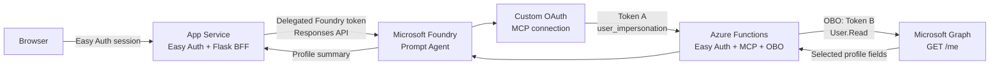
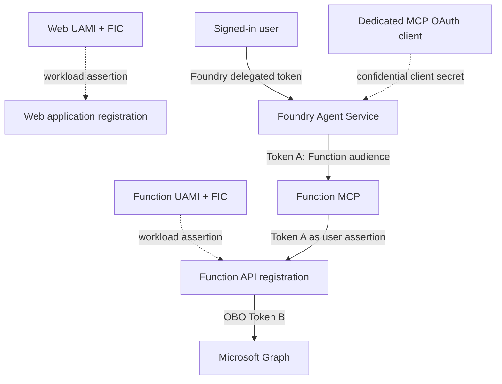
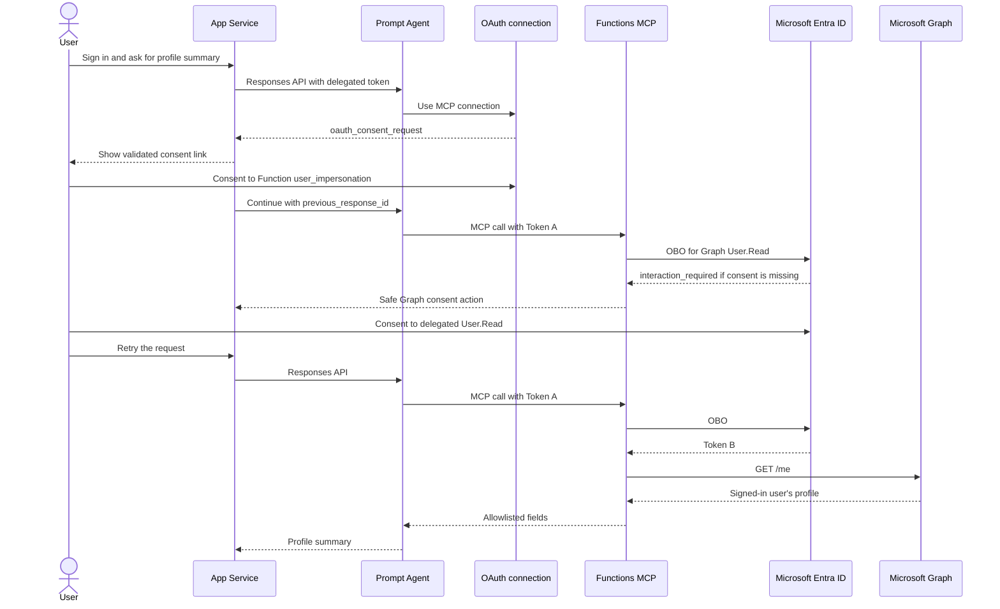

# Profile Summary Prompted Agent

App ServiceからMicrosoft Foundry Prompt AgentとAzure Functions MCPを通じてMicrosoft Graph `/me`を呼ぶ、ユーザー委任認証の再現可能なサンプルです。

> [!IMPORTANT]
> このリポジトリはprivate-firstで整備しています。Python tests、Bicep compile、greenfield deployment、2ユーザーE2E、cleanupまで検証済みです。Public化には、最終成果物の人間レビューと権利・ライセンス承認が別途必要です。

## Architecture



BrowserへFoundry、Function、Graphのaccess tokenを返しません。App Service Easy Authが検証したユーザー情報とprovider tokenをFlask BFFが受け取り、server-sideでFoundry Responses APIを呼び出します。

## Authentication Flow



| Artifact | Audience | Permission | Subject |
|---|---|---|---|
| Web provider token | Microsoft Foundry | Foundry delegated scope | Signed-in user |
| Token A | Function API | `user_impersonation` | Signed-in user |
| Token B | Microsoft Graph | `User.Read` | Signed-in user |
| UAMI assertion | Microsoft identity platform | `api://AzureADTokenExchange` | WebまたはFunction workload |

OAuth clientとFunction APIを同じApp Registrationにしません。Function Easy AuthはAPI applicationと専用OAuth clientの2 applicationだけをcallerとして許可します。

## First-use Sequence



## Prerequisites

- Azure subscription and a Microsoft Entra tenant where you can create applications and service principals
- Permission to create Azure role assignments
- Azure CLI, Azure Developer CLI, Azure Functions Core Tools, PowerShell 7
- Python 3.13
- Microsoft Graph PowerShell `Microsoft.Graph.Authentication`
- Model quota in the selected Foundry region

Model version、capacity、App Service SKU、regionsはparametersです。必ずpreflightで利用可能性を確認してください。

## Quick Start

```powershell
az login
azd auth login
azd env new
azd env set AZURE_SUBSCRIPTION_ID <subscription-id>
azd env set AZURE_LOCATION <primary-region>
azd env set WEB_LOCATION <web-region>

./scripts/preflight.ps1 -SetAzdEnvironment
./scripts/validate-local.ps1
azd provision
azd deploy

./scripts/configure-oauth-connection.ps1 `
  -ConfirmAzureWrite

./scripts/create-prompt-agent.ps1 -ConfirmAzureWrite
./scripts/verify-deployment.ps1 `
  -RequireAgent `
  -RequireNoFunctionApiSecrets
```

通常利用者にはProject scopeの`Foundry User`を割り当てます。

```powershell
./scripts/grant-foundry-user.ps1 `
  -ConfirmAzureWrite `
  -PrincipalId <user-object-id>
```

初回はFoundry MCP connectionとGraph `User.Read`の2つのユーザー同意が発生します。別ユーザーはfresh InPrivate browser contextで個別に検証してください。

検証後はtenant-scope Entra objectsを含めてcleanupします。

```powershell
./scripts/cleanup-validation-environment.ps1 `
  -ConfirmAzureWrite `
  -EnvironmentName <environment-name> `
  -SubscriptionId <subscription-id> `
  -TenantId <tenant-id> `
  -ResourceGroup <resource-group> `
  -RemoveAzdEnvironment
```

## Local Validation

```powershell
python -m venv .venv
./.venv/Scripts/python -m pip install `
  -r ./src/web/requirements.txt `
  -r ./src/function/requirements.txt `
  -r ./requirements-dev.txt
./scripts/validate-local.ps1
```

検証対象は45件のunit tests、Function metadata、PowerShell parser、Bicep compile、機密情報pattern scan、sanitized imageのoffline OCRです。Release scanでは、repo外に保存した固有denylistを`SENSITIVE_TERMS_FILE`へ設定し、`-RequireDenylist`を追加します。

## Documentation

- [Architecture](docs/architecture.md)
- [Authentication](docs/authentication.md)
- [Deployment](docs/deployment.md)
- [Security and privacy](docs/security-and-privacy.md)
- [Troubleshooting](docs/troubleshooting.md)
- [Foundry RBAC](docs/foundry-rbac.md)
- [Teams considerations](docs/teams-considerations.md)
- [Public release checklist](docs/public-release-checklist.md)

## Scope and Limitations

このsampleは開発・検証用です。public endpoints、App Service Easy Auth、short-lived OAuth client secretを使用し、private networkingやproduction SLAを提供しません。Teams、Azure Bot Service、Activity Protocolの実装は含みません。

## Official References

- [App Service user identities](https://learn.microsoft.com/en-us/azure/app-service/configure-authentication-user-identities)
- [App Service MCP authorization](https://learn.microsoft.com/en-us/azure/app-service/configure-authentication-mcp)
- [Foundry MCP authentication](https://learn.microsoft.com/en-us/azure/foundry/agents/how-to/mcp-authentication)
- [Azure Functions MCP bindings](https://learn.microsoft.com/en-us/azure/azure-functions/functions-bindings-mcp)
- [OAuth 2.0 On-Behalf-Of flow](https://learn.microsoft.com/en-us/entra/identity-platform/v2-oauth2-on-behalf-of-flow)
- [Microsoft Graph Get user](https://learn.microsoft.com/en-us/graph/api/user-get?view=graph-rest-1.0)
- [Azure Developer CLI](https://learn.microsoft.com/en-us/azure/developer/azure-developer-cli/overview)
