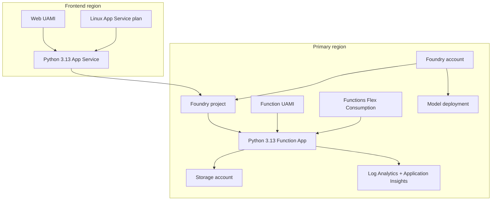
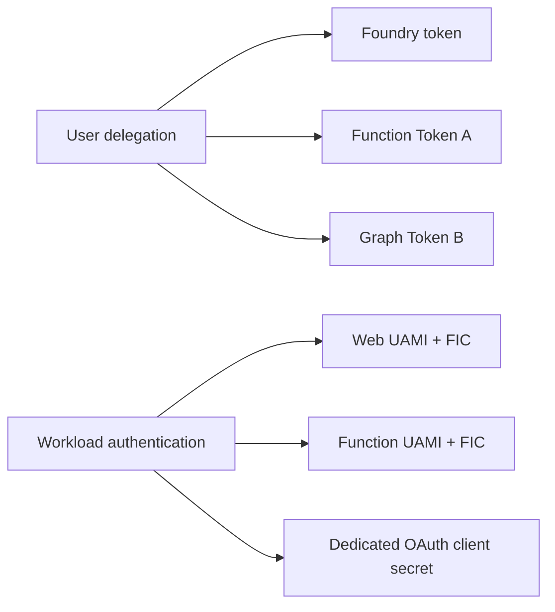
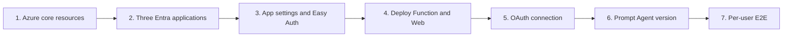

# Architecture

## Design Goal

サインインユーザー本人のidentityをApp ServiceからMicrosoft Foundry、Azure Functions、Microsoft Graphまで維持し、`GET /me`の結果だけをPrompt Agentへ返します。Shared managed identityやGraph application permissionでユーザーを置き換えません。

## Components

| Component | Responsibility |
|---|---|
| Browser | App Service Easy Authへのsign-in、per-user consent、chat操作 |
| App Service Easy Auth | 認証必須化、claimsとFoundry provider tokenのheader注入、token store |
| Flask BFF | Easy Auth context検証、same-origin enforcement、Responses API呼び出し、安全なconsent action |
| Foundry Prompt Agent | `get_my_profile`選択、MCP connection利用、profile要約 |
| Foundry custom OAuth connection | Project、connection、user単位のdelegated credential保持とToken A更新 |
| Functions Easy Auth | Token Aのissuer、audience、caller application検証 |
| Functions MCP | Token Aをuser assertionとしてOBOを実行し、Graph responseをfield allowlistへ正規化 |
| Microsoft Graph | Delegated `User.Read`でsigned-in userの`/me`を返す |

## Resource Topology

`location`と`webLocation`は独立parametersです。同一regionを指定できますが、quotaやApp Service availabilityに応じて分離できます。

## Request Path

1. BrowserはApp Service Easy Authへsign-inします。
2. Easy Authは検証済みclaimsを`X-MS-CLIENT-PRINCIPAL`、Foundry provider tokenを`X-MS-TOKEN-AAD-ACCESS-TOKEN`へ注入します。
3. Flask BFFはtokenをBrowserへ返さず、`AIProjectClient`経由でResponses APIを呼びます。
4. Responses APIには`agent_reference`と、multi-turn時だけ`previous_response_id`を渡します。
5. Agentはallowlistされた`get_my_profile`だけをFunctions MCPへ要求します。
6. Foundry OAuth brokerはFunction API audienceのToken AをMCP requestへ付与します。
7. Function Easy AuthがToken Aを検証し、MCP extensionが`/runtime/webhooks/mcp`へrouteします。
8. FunctionはToken AをOBOでGraph Token Bへ交換し、`GET /me`を呼びます。
9. Functionは選択済みfieldだけをAgentへ返し、Agentが自然文へ要約します。

## Identity Boundaries

User delegationは「誰の権限で処理するか」、workload authenticationは「どのapplicationとしてtoken endpointへ認証するか」を表します。UAMIがclient assertionに使われても、OBOのuser assertionはToken Aであり、Graph Token Bのsubjectはsigned-in userです。

## Data Boundary

FunctionはGraphへ次のfieldだけを`$select`で要求し、同じallowlistでresponseを再構築します。

- `displayName`
- `givenName`
- `surname`
- `jobTitle`
- `department`
- `officeLocation`
- `city`
- `state`
- `country`
- `preferredLanguage`
- `businessPhones`

Object ID、UPN、mail、mobile phone、raw claims、raw Graph responseはAgent responseへ含めません。

## Deployment Order

BicepのMicrosoft Graph extensionはapp registration、service principal、FICを作成します。Foundry custom OAuth connectionのsecretとcallback URIはpost-provision scriptで構成します。

## Production Considerations

このsampleはpublic endpointsを使用します。Productionでは、network isolation、private MCP support、regional redundancy、App Service tier、monitoring retention、secret rotation、Conditional Access、supportabilityを個別に設計してください。

## References

- [App Service user identity headers](https://learn.microsoft.com/en-us/azure/app-service/configure-authentication-user-identities)
- [Foundry MCP tool](https://learn.microsoft.com/en-us/azure/foundry/agents/how-to/tools/model-context-protocol)
- [Functions MCP bindings](https://learn.microsoft.com/en-us/azure/azure-functions/functions-bindings-mcp)
