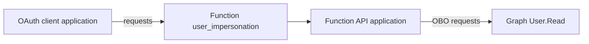
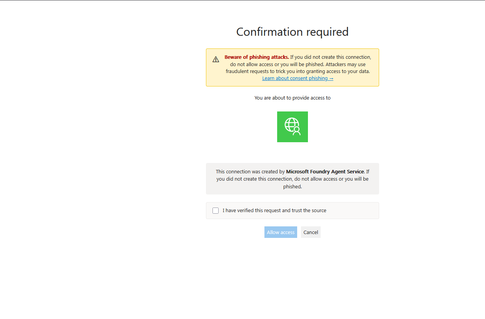
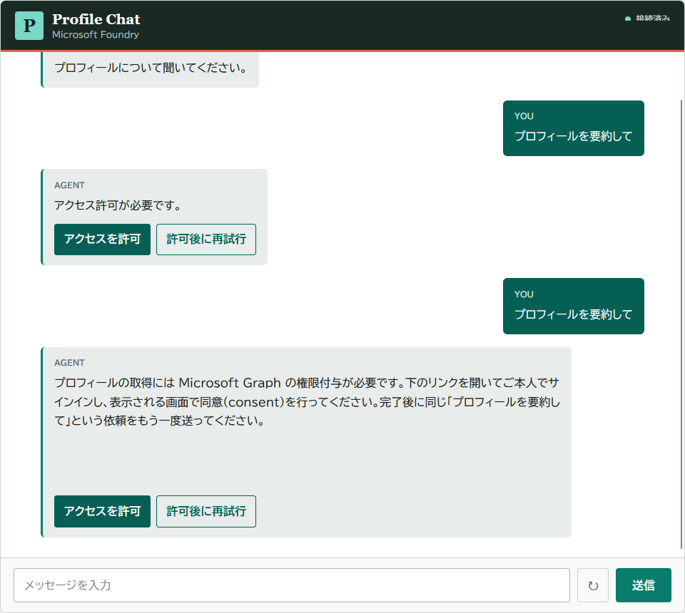
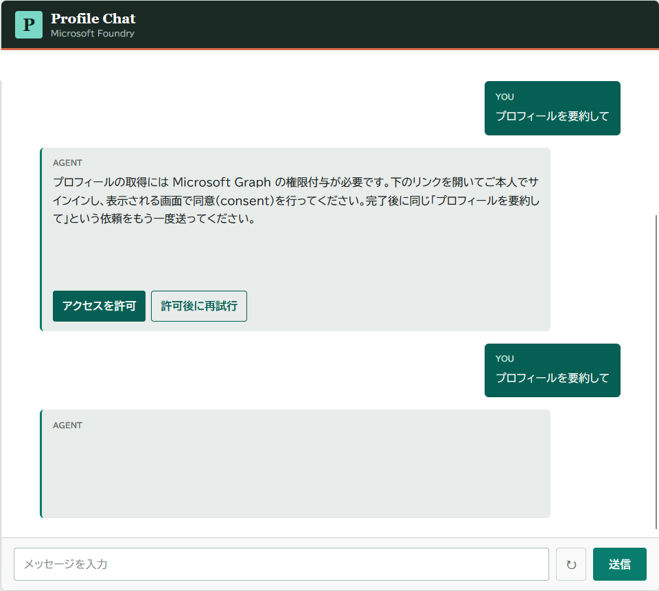
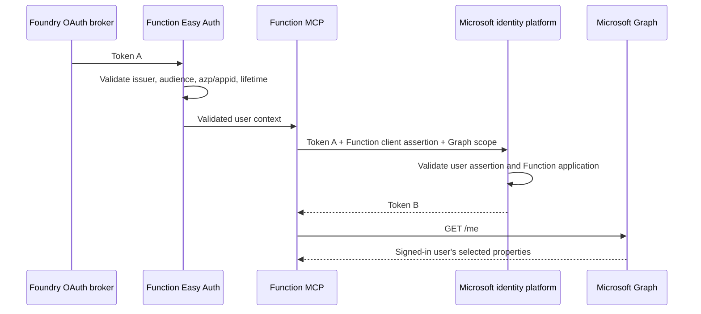

# Authentication

## Three Application Registrations

| Application | Role | Required permission | Credential |
|---|---|---|---|
| Web application | App Service Easy Auth client、Foundry delegated token取得 | Foundry delegated scopeのみ | Web UAMI + FIC |
| Function API | Protected API、Easy Auth resource、Graph OBO middle tier | Exposes `user_impersonation`; requests Graph delegated `User.Read` | Function UAMI + FIC |
| MCP OAuth client | Foundry custom OAuth confidential client | Function delegated `user_impersonation`のみ | Short-lived client secret |

OAuth clientとFunction APIは別registrationです。同じapplicationをclientとresourceの両方にすると、名前ベースのApp ID URIに対するself-token requestが`AADSTS90009`で拒否される場合があります。

## Why the Split Matters

専用OAuth clientはAPI scopeを公開せず、Graph permissionも要求しません。Function APIはFoundry callbackやFoundry connection secretを持ちません。

## Workload Credentials

WebとFunctionはUser-assigned managed identityをApp Serviceへattachします。各Entra applicationには次のfederated identity credentialを作成します。

| Property | Value |
|---|---|
| Issuer | Tenant-specific Microsoft identity platform v2 endpoint |
| Subject | UAMI principal ID |
| Audience | `api://AzureADTokenExchange` |

Easy Authと`OnBehalfOfCredential`はUAMIが取得したassertionをapplication credentialとして使います。FICはpermissionを付与せず、「このUAMIをapplication credentialとして信頼する」という関係だけを定義します。

## Tokens

### Web Provider Token

- Audience: `https://ai.azure.com`
- Subject: signed-in user
- Stored by: App Service Easy Auth token store
- Used by: Flask BFF to call Foundry Responses API

Flaskは`EasyAuthTokenCredential`でscopeを`https://ai.azure.com/.default`へ限定し、期限切れtokenを拒否します。

### Token A

- Audience: Function API identifier URI
- Scope: delegated `user_impersonation`
- Subject: signed-in user
- Client: dedicated MCP OAuth client
- Validated by: Function Easy Auth

Function Easy Authの`allowedApplications`はFunction API applicationとdedicated OAuth clientの2件だけです。後者を追加しない場合、EntraがToken Aを正常発行してもFunction runtime到達前に403となります。

### Token B

- Audience: Microsoft Graph
- Scope: delegated `User.Read`
- Subject: signed-in user
- Obtained by: Function OBO flow

Token AをGraphへforwardしません。FunctionはToken Aをuser assertion、Function UAMI assertionをclient credentialとしてToken Bを取得します。

## Consent Boundaries

初回利用には2つの独立したconsentがあります。

1. Foundry MCP consent
   - Project、connection、user単位
   - Function API `user_impersonation`
   - `oauth_consent_request.consent_link`をclientが表示
   - Consent後は`previous_response_id`で処理を継続
2. Graph consent
   - Function API applicationとuser単位
   - Microsoft Graph `User.Read`
   - Function Easy Auth login routeでinteractive consent

`knownClientApplications`と`preAuthorizedApplications`は設定しません。Foundry consentとGraph consentをbundleせず、per-user consentを明示的に維持します。

## OBO Sequence

OBOはdelegated user tokenでのみ機能します。Application-only tokenやshared project identityでは`/me`を呼べません。

## Token Refresh

Foundry custom OAuth connectionはFunction scopeと`offline_access`を要求し、token URLをrefresh URLにも設定します。通常はaccess token expiryをbrokerが処理します。次の場合は再同意が必要です。

- OAuth client IDを変更した
- Userまたはadministratorがgrantをrevokeした
- Connectionを削除、再作成、改名した
- Refresh tokenが失効した
- Conditional Accessがinteractive authenticationを要求した

## Security Invariants

- Browser JavaScriptへaccess tokenを返さない
- Consent URLはHTTPS、default port、Microsoft-managed consent hostだけを許可
- Function toolはuser identifierをargumentとして受け取らない
- Function API applicationのpassword credentialは0件
- OAuth client secretは短期、値をstdoutやsourceへ出さない
- Graph application permissionを付与しない
- `GET /me`以外のuser lookupを実装しない

## References

- [Foundry MCP authentication](https://learn.microsoft.com/en-us/azure/foundry/agents/how-to/mcp-authentication)
- [App Service MCP authorization](https://learn.microsoft.com/en-us/azure/app-service/configure-authentication-mcp)
- [OAuth 2.0 On-Behalf-Of flow](https://learn.microsoft.com/en-us/entra/identity-platform/v2-oauth2-on-behalf-of-flow)
- [Microsoft Graph Get user](https://learn.microsoft.com/en-us/graph/api/user-get?view=graph-rest-1.0)
