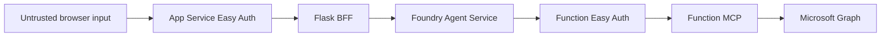

# Security and Privacy

## Trust Boundaries

各boundaryでauthentication、authorization、input/output restrictionを別々に適用します。

## Browser and BFF

- Browser JavaScriptへFoundry、Function、Graph tokenを返さない
- `X-MS-CLIENT-PRINCIPAL`とprovider token headerはEasy Authが注入したものだけを信頼する
- POSTはsame-origin、JSON content type、16 KiB request、2,000文字messageへ制限する
- `previous_response_id`は形式を検証し、Browser memoryだけで保持する
- CSP、`X-Frame-Options: DENY`、`nosniff`、`no-store`を付与する
- CORSはWeb App自身のHTTPS origin 1件だけを許可し、credentialsを有効にする

## Consent Links

Foundryが返すconsent URLは次をすべて満たす場合だけUI actionに変換します。

- HTTPS
- Userinfoなし
- Default port
- Microsoft-managed consent host suffix
- Runtime configurationでsuffixを追加できない

Raw consent URLをapplication log、ticket、documentationへ保存しません。古いlinkや別ユーザーのlinkを再利用しません。

## Function API

- Easy Authでauthentication必須、unauthenticated requestは401
- Token A audienceはFunction API identifier URI
- Caller applicationはFunction APIとdedicated OAuth clientの2件だけ
- Toolはuser ID、UPN、mailをargumentとして受け取らない
- Identity sourceはMCP contextに含まれる検証済みEasy Auth headerだけ
- Token AをGraphへforwardせず、OBOで新しいToken Bを取得する

Functions MCP extensionのsystem key requirementは`host.json`でanonymousにし、Easy Authをidentity-based access control layerとして使用します。Easy Authを無効にした状態では公開しません。

## Microsoft Graph

- Delegated `User.Read`だけを要求する
- Application permissionを付与しない
- `GET /me`だけを呼び、`/users/{id}`を実装しない
- `$select`とresponse allowlistの両方でfieldを制限する
- Object ID、UPN、mail、mobile phone、raw responseをAgentへ返さない

## Workload Credentials

| Component | Credential | Secret status |
|---|---|---|
| Web Easy Auth | Web UAMI + FIC | Secretless |
| Function Easy Auth/OBO | Function UAMI + FIC | Secretless |
| Foundry custom OAuth broker | Dedicated OAuth client secret | Short-lived secret required |

OAuth client secretはsource、Bicep output、PowerShell output、CI logへ出しません。Rotationでは新credentialでconnectionを更新し、E2E成功後に古いcredentialを削除します。

## Telemetry

Application telemetryはallowlist eventとsanitized fieldsだけを記録します。

- Component、event type、safe error code、duration
- Random correlation ID
- HMAC-based user fingerprint。Key未設定時は`unavailable`

次は記録しません。

- Access token、refresh token、client secret
- Raw claims、raw Graph response、raw upstream error body
- UPN、mail、object ID、phone number
- Consent URL、callback URL、session fragment

## Repository Privacy

Private repositoryを機密情報対策として扱いません。Commit前に次を実行します。

- External denylist scan
- Email、tenant domain、subscription path、unreviewed GUID scan
- Gitleaks directory scan
- Screenshot metadataとOCR scan
- Binary allowlist review
- Source tree hash comparison

GitHub ActionsにはAzure credentialを設定せず、live deploymentを実行しません。Privateからpublicへ変更するとActions historyとlogも公開されるためです。

## Browser Validation

複数ユーザー検証では、ユーザーごとにfresh InPrivateまたはPlaywright BrowserContextを作成します。

- 同じcontext内でaccount switchしない
- Cookie、storage state、profileを再利用しない
- Screenshot、trace、HAR、video、logへidentity/tokenを残さない
- 検証後にcontextを破棄する

## Production Gaps

このsampleはpublic endpointsを使用し、private networkingを構成しません。Productionでは次を追加検討します。

- Private endpoints、VNet integration、private MCP support
- Regional redundancyとdisaster recovery
- Central secret rotationとexpiration alert
- Diagnostic settings、retention、SIEM integration
- Conditional Accessとtenant consent policy
- Rate limiting、abuse protection、WAF/API gateway
- MCP tool approval policyとaudit

## References

- [App Service MCP authorization](https://learn.microsoft.com/en-us/azure/app-service/configure-authentication-mcp)
- [App Service user identities](https://learn.microsoft.com/en-us/azure/app-service/configure-authentication-user-identities)
- [OBO flow](https://learn.microsoft.com/en-us/entra/identity-platform/v2-oauth2-on-behalf-of-flow)
