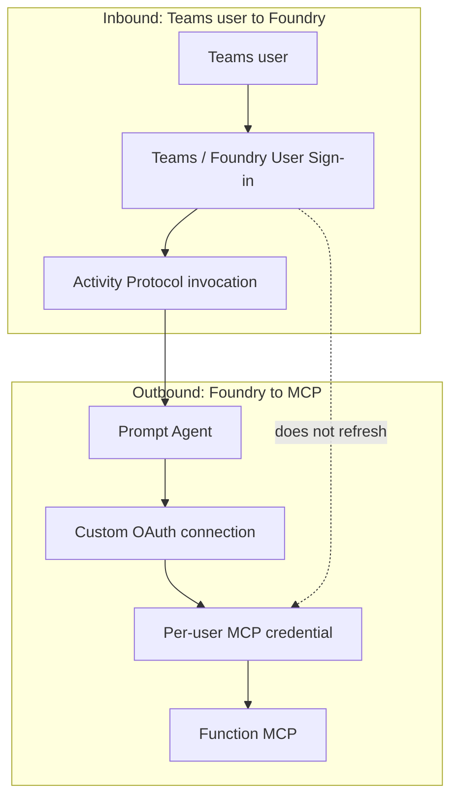
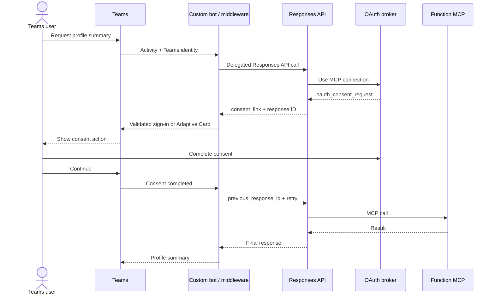

# Teams Considerations

## Status

Teams、Azure Bot Service、Activity Protocol、Teams manifestはこのrepositoryの実装対象外です。この文書は、同じPrompt AgentをTeamsから利用する場合に発生するauthentication boundaryと、自己復旧UXに必要な追加設計を記録します。

## Two Independent User Authentications

| Authentication | Purpose | Credential owner |
|---|---|---|
| Teams / Foundry User Sign-in | Userがpublished Agentを呼び出す | Teams、Azure Bot Service、Foundry Activity Protocol |
| MCP OAuth consent | Foundryが同じuserとしてFunction MCPを呼び出す | Foundry OAuth broker、project/connection/user単位 |

TeamsのUser Sign-inを完了しても、MCP credentialのconsent、refresh token、Token Aは更新されません。

## Managed Activity Protocol Limitation

FoundryのOAuth identity passthroughでは、呼び出し側clientが次を実装する必要があります。

1. Responses API outputの`oauth_consent_request`を検出する。
2. Dynamic `consent_link`をuserへ表示する。
3. Consent完了後に`previous_response_id`を送って処理を継続する。

Azure Bot Serviceからmanaged Activity Protocolへ直接接続する経路には、このResponses API outputを処理するcustom client hookがありません。MCP authentication failureが`tool_user_error`としてactivityへ変換された場合、dynamic consent linkとresponse continuationをTeamsへ戻せません。

この制約はPrompt instructionやTeams manifestだけでは解消できません。

## Why Common Workarounds Do Not Repair MCP Consent

| Attempt | Why it does not repair the MCP credential |
|---|---|
| Teams User Sign-inを再実行 | Inbound Foundry authenticationであり、Function API向けoutbound consentではない |
| Teams appを再install | Teams installation stateとFoundry per-user credential storeは別 |
| Agent promptで401を捕捉 | Transport/auth failureはmodelのnormal response生成前に終了する場合がある |
| Manifestに認証commandを追加 | Commandは入力候補であり、dynamic consent linkやstateを生成しない |
| Static authorize URLを掲載 | Foundry consent linkにuser、connection、callback、stateが含まれる |
| Tenant-wide admin consent | Permission grantとFoundry brokerのper-user credentialは別 |
| Connectionを再作成 | 全ユーザーへ新consentを要求し、bindingとversionへ影響する |

## Per-user Credential Behavior

OAuth identity passthroughはuser identityを維持するため、credentialもuserごとに独立します。あるuserのre-consentは別userへ波及しません。

一般化したvalidationでは次を観測しました。

- Expired Token AがFunction Easy Authで401となる場合がある
- 同じuserがResponses API経由で新しいconsentを完了すると成功する
- 別userは自身のcredential stateに応じて独立して失敗または成功する
- `offline_access`とrefresh URLが存在しても、grant revocation、client変更、Conditional Accessなどでinteractive consentが再度必要になり得る

## Self-service Recovery Architecture

Teams内でconsentとretryを完結させるには、Azure Bot ServiceとFoundryの間にcustom botまたはmiddlewareを置きます。

Middlewareのresponsibilities:

- Teams SSOまたはOAuthでuserを認証する
- User delegated Foundry tokenを取得する
- Responses APIを呼ぶ
- `oauth_consent_request`と`mcp_approval_request`を処理する
- Consent URLのscheme、host、port、userinfoを検証する
- `previous_response_id`とTeams conversationを短時間だけ安全に関連付ける
- Token、consent URL、response ID、UPNをlogしない
- Retry、expiry、declined consent、Conditional Accessを明示的に扱う

## Operational Recovery without Custom Middleware

Managed Activity Protocolを維持する場合、operator-assisted recoveryになります。

1. Teams errorのUTC timeとsanitized activity correlationを記録する。
2. 対象user本人のdelegated identityでResponses APIを呼び、MCP toolを発火する。
3. 新しく返されたconsent actionを対象userだけへ表示する。
4. Consent完了後、同じuserで処理を継続する。
5. Teamsから新しいmessageを送り、Function MCPとGraph `/me`を確認する。

Consent URLは短期stateを含むため、ticket、Wiki、chat historyへ保存しません。別userへ転送しません。

## Decision for This Repository

Teams implementationを含めない理由:

- App Service sampleの認証境界と再現手順を明確に保つ
- Managed Activity ProtocolではOAuth continuation UXを実装できない
- Custom botは別host、Teams SSO/OBO、state store、cards、monitoringを必要とする独立project
- Bot manifest、catalog publish、tenant administrationがsampleのblast radiusを広げる

将来Teams対応を実装する場合は、別repositoryまたは独立moduleとして設計し、このsampleのWeb/Function auth contractをAPI boundaryとして再利用します。

## References

- [Foundry MCP authentication](https://learn.microsoft.com/en-us/azure/foundry/agents/how-to/mcp-authentication)
- [Agent applications and Activity Protocol](https://learn.microsoft.com/en-us/azure/foundry/agents/how-to/agent-applications)
- [OAuth authentication for Teams bots](https://learn.microsoft.com/en-us/microsoftteams/platform/bots/how-to/authentication/add-authentication)
