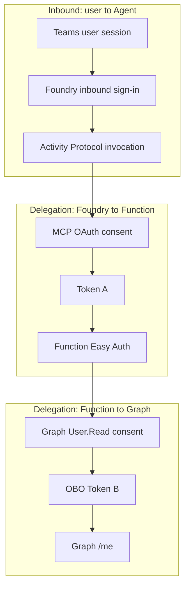
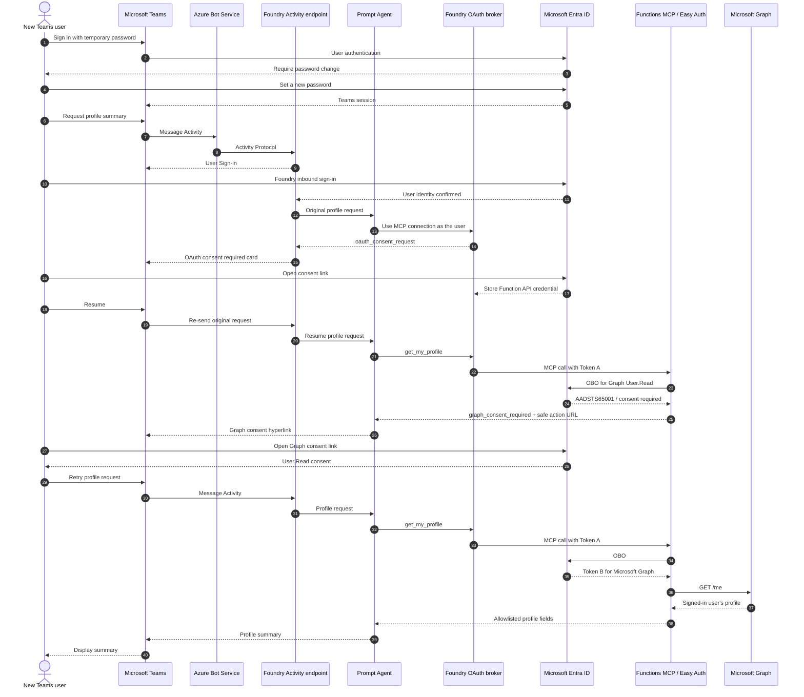
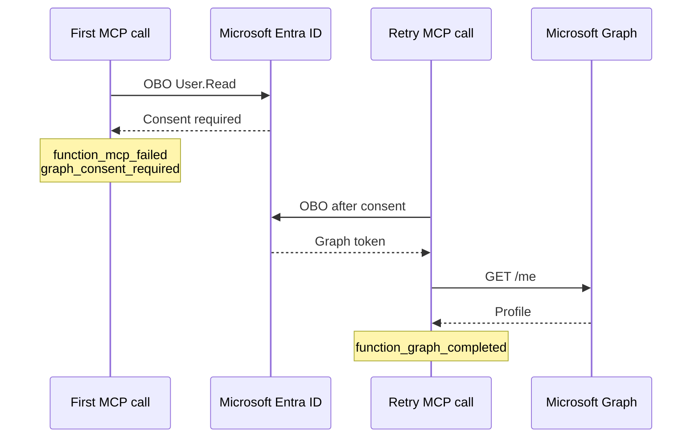

# Teams New User Authentication Flow

## Purpose

この文書は、新規ユーザーがMicrosoft Teamsだけをfrontendとして使用し、Microsoft Foundry Prompt Agent、Azure Functions MCP、Microsoft Graphを経由して本人のプロフィール要約を取得するまでの認証フローを説明します。

検証は、次の初期状態を持つcloud-only test userで実施しました。

- Microsoft Teamsを利用できるlicense
- 対象Foundry project scopeの`Foundry User`
- 架空のプロフィール情報
- User-specific OAuth grantは0件

この状態からTeams Web Clientで初回sign-inと各consentを実行し、最終的にMicrosoft Graph `/me`の結果に基づくプロフィール要約が成功しました。

> [!NOTE]
> このrepositoryはTeams app、Azure Bot Service、Activity Protocolのprovisioningを含みません。この文書は、同じPrompt AgentとFunction MCP backendをTeamsへ公開した場合に検証したintegration flowを記録します。

## Summary

Teams frontendだけで、次の半自動認証フローを実行できます。

```mermaid
flowchart LR
    User["New Teams user"]
    Teams["Microsoft Teams"]
    FoundrySignIn["Foundry inbound sign-in"]
    McpConsent["MCP OAuth consent card"]
    Resume["Resume"]
    GraphConsent["Graph consent link"]
    Retry["Retry profile request"]
    Summary["Profile summary"]

    User --> Teams
    Teams --> FoundrySignIn
    FoundrySignIn --> McpConsent
    McpConsent --> Resume
    Resume --> GraphConsent
    GraphConsent --> Retry
    Retry --> Summary
```



すべてが1つの認証ではありません。Teamsから最終結果を得るまで、異なる目的とaudienceを持つ認証・認可境界を順番に通過します。

| Order | Authentication boundary | User action | Result |
|---:|---|---|---|
| 0 | Entra user first sign-in | Temporary passwordでsign-inし、新しいpasswordへ変更 | Teams user sessionを確立 |
| 1 | Teams / Foundry inbound sign-in | `User Sign-in`またはFoundry login linkを開く | Teams userとしてAgentを呼び出せる |
| 2 | Foundry MCP OAuth identity passthrough | `OAuth consent required` cardから同意し、`Resume` | Function API向けdelegated Token AをFoundry brokerが取得可能になる |
| 3 | Function / Microsoft Graph consent | Agentが表示するGraph consent linkを開く | Function appに対するGraph delegated `User.Read` grantを作成 |
| 4 | Profile request retry | Teamsへ戻り、同じ依頼を再送 | OBOとGraph `/me`が成功し、要約を表示 |

第2段階はFoundry platformが提供するnative cardと`Resume`を使用します。第3段階は通常のTeams hyperlinkなので、Graph consent完了後に自動Resumeされません。ユーザーがTeamsへ戻ってprofile requestをもう一度送る必要があります。

## Architecture

```mermaid
flowchart LR
    User["Teams user"]
    Teams["Microsoft Teams<br/>personal app"]
    Bot["Azure Bot Service<br/>Teams channel"]
    Activity["Foundry Agent endpoint<br/>Activity Protocol"]
    Agent["Prompt Agent"]
    Broker["Foundry OAuth broker<br/>per-user credential"]
    OAuthClient["Dedicated MCP OAuth client<br/>confidential client"]
    Function["Azure Functions MCP<br/>Easy Auth + OBO"]
    FunctionApp["Function Entra application<br/>protected API / OBO client"]
    Graph["Microsoft Graph<br/>GET /me"]

    User --> Teams
    Teams --> Bot
    Bot --> Activity
    Activity --> Agent
    Agent --> Broker
    Broker --> OAuthClient
    OAuthClient -->|"Token A<br/>user_impersonation"| Function
    Function --> FunctionApp
    FunctionApp -->|"OBO: Token B<br/>User.Read"| Graph
    Graph --> Function
    Function --> Agent
    Agent --> Teams
```



### Component Responsibilities

| Component | Responsibility |
|---|---|
| Teams | User conversation、Foundry sign-in card、MCP OAuth consent card、通常のGraph consent hyperlinkを表示する |
| Azure Bot Service | Teams ActivityをFoundry Activity Protocol endpointへ中継する |
| Foundry Agent endpoint | Teamsからのinbound identityとconversationを管理し、Agent versionへrouteする |
| Prompt Agent | Profile requestで`get_my_profile`を選択し、tool resultから要約またはGraph consent案内を生成する |
| Foundry OAuth broker | Project、connection、user単位でMCP credentialを保持し、Function audienceのToken AをMCP callへ付与する |
| Azure Functions MCP | Token Aのuser contextを検証し、OBOでGraph用Token Bを取得する |
| Microsoft Graph | Delegated `User.Read`に基づき、signed-in user本人の`/me`だけを返す |

## Authentication Boundaries and Tokens



| Credential / token | Subject | Audience | Scope / permission | Usage |
|---|---|---|---|---|
| Teams session | Teams user | Microsoft Teams | Teams利用権 | Teams Web Client |
| Foundry inbound credential | Teams user | Microsoft Foundry | Agent invocation | TeamsからFoundry Activity endpointを呼ぶ |
| Token A | Same Teams user | Function API | `user_impersonation` | Foundry brokerからFunction Easy Authへ渡し、OBO user assertionとして使う |
| Function workload assertion | Function UAMI | `api://AzureADTokenExchange` | FIC trust | Function appがOBO confidential clientとしてEntraへ自分を証明する |
| Token B | Same Teams user | Microsoft Graph | `User.Read` | FunctionからGraph `/me`を呼ぶ |

Token AとToken Bは同じユーザーを表しますが、audienceが異なるため使い回せません。FunctionはToken AをOBOの`user_assertion`としてEntraへ渡し、Graph audienceのToken Bを取得します。

### Applications Shown During Sign-in

新規ユーザーが画面上で見るapplicationは、1つのapplicationを繰り返し承認しているわけではありません。

| Client role | Resource role | Purpose |
|---|---|---|
| Foundry first-party client | Foundry service | Teams userとしてFoundry Agentを利用するinbound sign-in |
| Dedicated MCP OAuth client | Function API | Foundry brokerがFunction APIの`user_impersonation`を取得するMCP consent |
| Function application | Microsoft Graph | FunctionがOBOでGraph `User.Read`を取得するdownstream consent |

Client、resource、token audienceが異なるため、ある段階のsign-in成功だけで後段のpermissionは付与されません。

## Complete First-use Sequence



## User Operations in Teams

### Step 1: First Sign-in to Teams

1. 新規test userのUPNとtemporary passwordでTeamsへsign-inします。
2. Entraからpassword変更を要求されたら、新しいpasswordを設定します。
3. Teams右上のaccountが対象test userであることを確認します。

Tenant policyによってはMFA registrationなどの追加操作が表示される場合があります。これはTeams sessionを確立する処理で、MCPやGraph consentとは別です。

### Step 2: Foundry Inbound Sign-in

Profile requestを送ると、必要に応じて`User Sign-in`またはFoundry login linkが表示されます。このsign-inはTeams userとFoundry Agent invocationを関連付けます。

### Step 3: MCP OAuth Consent

Agentが`get_my_profile`を使用しようとすると、Teamsに次のnative cardが表示されます。

- `OAuth consent required`
- `Open consent link`
- `Resume`

`Open consent link`を開き、対象accountと要求scopeを確認してconsentします。Browser側の完了後、**必ず元のcardの`Resume`を押します**。`Resume`はconsent待ちで中断した元requestを再送します。

### Step 4: Microsoft Graph Consent

Function MCPへのcallが成功しても、新規ユーザーにはGraph `User.Read` grantがありません。Functionの最初のOBOは`AADSTS65001`となり、AgentがTeams messageにGraph consent hyperlinkを表示します。

Linkを開いてFunction applicationとGraph `User.Read`を承認します。このlinkは通常のTeams hyperlinkであり、native MCP consent cardではありません。

### Step 5: Retry the Profile Request

Graph consent完了後はTeamsへ戻り、同じprofile requestをもう一度送ります。今回はOBOが成功し、Graph `/me`の結果から要約が生成されます。

## Sanitized Validation Evidence

検証開始前はuser-specific OAuth grantが0件でした。個人名、UPN、tenant/resource identifiers、timestamp、correlation IDは公開Evidenceに含めません。

### Entra Sign-in Sequence

| Order | Client role | Resource role | Result | Meaning |
|---:|---|---|---|---|
| 1 | Teams Web Client | Microsoft Graph | Expected first-sign-in interrupt | Temporary passwordの変更を要求 |
| 2 | Teams Web Client | Microsoft Graph | Success | Teams sign-in完了 |
| 3 | Foundry first-party client | Foundry service | Success | Foundry inbound sign-in完了 |
| 4 | Dedicated MCP OAuth client | Function API | Success | MCP OAuth interactive sign-in完了 |
| 5 | Function application | Microsoft Graph | `AADSTS65001` | Graph delegated consent不足を検出 |
| 6 | Function application | Microsoft Graph | Success | Graph `User.Read` consent完了 |
| 7 | Function application | Microsoft Graph | Success | Graph credentialの後続利用成功 |

成功eventではConditional Access requirementsをinteractive browser flowで満たしました。

### Function Authentication Telemetry



検証では次の安全なevent sequenceを確認しました。

1. `function_mcp_started`
2. `function_mcp_failed` with `graph_consent_required`
3. Graph consent完了
4. `function_mcp_started`
5. `function_graph_completed`

Graph consent前にprofile requestを複数回送ると、`graph_consent_required`が複数回記録されます。Graph consent後の再送では`function_graph_completed`となり、最終応答が成功しました。

### Final Delegated Grant

最終的に、Function applicationからMicrosoft Graphへのuser-specific Principal grantが作成されました。

| Client role | Resource | Scopes | Consent type |
|---|---|---|---|
| Function application | Microsoft Graph | `openid profile email offline_access User.Read` | `Principal` |

Foundry OAuth brokerはproject、connection、user単位でper-user credentialを保持します。このため、Graphの`oauth2PermissionGrant`だけではMCP broker内credentialの有無を完全には表せません。MCP consent成功は、MCP toolがFunctionへ到達したruntime evidenceとEntra sign-in evidenceを組み合わせて判断します。

## Troubleshooting

| Symptom | Boundary | Action |
|---|---|---|
| Teamsへsign-inできない | Teams / Entra user authentication | License、password変更、MFA、account enabledを確認 |
| `User Sign-in`が繰り返される | Teams to Foundry inbound sign-in | 対象account、Foundry role、Conditional Accessを確認 |
| `OAuth consent required` cardが繰り返される | Foundry broker to Function API | 同じaccountでconsentしたか、同じcardで`Resume`したか確認 |
| Tool progressのまま停止 | Conversationに未完了tool callが残った | `/foundry_new_preview`を送ってfresh conversationへreset |
| Graph consent linkが表示される | Function OBOでGraph grant不足 | Linkを開いて同意し、Teamsへ戻って依頼を再送 |
| Graph consent後も同じlinkが出る | Graph grantまたはFunction Easy Auth sessionが未完了 | Entra sign-in log、Principal grant、account一致を確認 |
| Raw HTTP 401 / expired token | 保存済みMCP credentialのrefresh failure | `offline_access`、refresh URL、credential re-consentを確認し、必要ならSupportへ調査依頼 |

### Reset a Locked Conversation

Microsoft公式troubleshootingでは、tool error後にTeams conversationがlocked stateとなり後続messageも失敗する場合、次を送るよう案内しています。

```text
/foundry_new_preview
```

Reset前のconversationは復元できません。Consent途中で停止した場合は、reset後のfresh conversationで最初からやり直します。

## Security Considerations

- Consent linkは短期stateを含むため、document、ticket、application logへ保存しません。
- 別ユーザーへconsent linkを転送しません。
- Access token、refresh token、raw claims、Authorization headerを表示・記録しません。
- Functionはuser IDをtool引数として受け取らず、Easy Authが検証したToken Aのidentityを使用します。
- Graphはdelegated `User.Read`で`GET /me`だけを呼びます。
- Agentへ返すprofileはallowlist済みfieldだけに制限します。
- Foundry OAuth connectionはper-user credentialを別ユーザーと共有しません。

## Validation Checklist

### Before Testing

- [ ] New user has licenses required to use Teams
- [ ] Account is enabled and usage location is configured
- [ ] User has the expected Foundry role at the intended scope
- [ ] User-specific OAuth grant count is zero
- [ ] Use a fresh InPrivate browser or isolated browser profile

### During Testing

- [ ] Temporary password is changed and Teams sign-in succeeds
- [ ] Foundry inbound sign-in succeeds
- [ ] MCP OAuth consent card appears
- [ ] User selects `Resume` on the same card after consent
- [ ] Graph consent hyperlink appears
- [ ] User completes `User.Read` consent
- [ ] User retries the profile request
- [ ] Only the signed-in user's profile is summarized

### Evidence

- [ ] Entra sign-in logs show the three client/resource boundaries
- [ ] Function telemetry contains `graph_consent_required`
- [ ] Function telemetry contains `function_graph_completed` after consent
- [ ] A user-specific Graph grant exists with consent type `Principal`
- [ ] Logs contain no tokens, object IDs, consent URLs, or raw Graph response

## References

- [Foundry MCP authentication](https://learn.microsoft.com/en-us/azure/foundry/agents/how-to/mcp-authentication)
- [Publish agents to Microsoft 365 and Teams](https://learn.microsoft.com/en-us/azure/foundry/agents/how-to/publish-copilot)
- [Published agent troubleshooting](https://learn.microsoft.com/en-us/azure/foundry/agents/how-to/publish-copilot-virtual-network#troubleshooting)
- [Customize Teams agent messages](https://learn.microsoft.com/en-us/microsoftteams/platform/bots/how-to/format-your-bot-messages)
- [OAuth 2.0 On-Behalf-Of flow](https://learn.microsoft.com/en-us/entra/identity-platform/v2-oauth2-on-behalf-of-flow)
- [Microsoft identity platform error codes](https://learn.microsoft.com/en-us/entra/identity-platform/reference-error-codes)
- [Microsoft Agent Framework OAuth consent implementation](https://github.com/microsoft/agent-framework/blob/main/dotnet/src/Microsoft.Agents.AI.Foundry.Hosting/AgentFrameworkResponseHandler.cs)

## Related Repository Documents

- [Architecture](architecture.md)
- [Authentication](authentication.md)
- [Foundry RBAC](foundry-rbac.md)
- [Security and privacy](security-and-privacy.md)
- [Troubleshooting](troubleshooting.md)